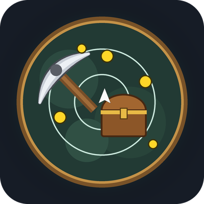

# ForeverTrack

A small addon for **World of Warcraft: Forever** that keeps the minimap trackings you choose
switched on, and reminds you when one of them is off.

Forever lets you run several trackings at once, but dying clears them and they're easy to forget after
a loading screen. ForeverTrack turns them back on for you.

## Features

- Works with **every tracking in the minimap menu**:
  - Gathering: Find Minerals, Find Herbs, Find Treasure, Find Fish
  - Class: Track Beasts, Humanoids, Undead, Hidden, Elementals, Demons, Giants, Dragonkin, Sense Undead, Sense Demons
  - Town: Flight Master, Mailbox, and the rest
- Turns ticked trackings on at login, after zoning and after you die.
- Gathering trackings are on by default. Class and town trackers are off until you tick them.
- Respects your choice: if you turn a tracking off yourself, it stays off.
- Pulsing reminder icon (out of combat only) when a ticked tracking is off. Hover to see which, click to fix, Shift-drag to move.
- **Hunters:** casting Hunter's Mark switches your tracking to the target's type (Beast, Humanoid, ...). No extra GCD if it's already on. Also works from a macro with `/ftrack match`, and in combat if you turn that on.
- Never acts in combat, unless you turn on in-combat Hunter's Mark switching. Works within Forever's addon restrictions.
- Only shows trackings your character actually has. Settings are saved per character.

## Install

- **CurseForge app:** choose World of Warcraft → **Forever** and install ForeverTrack.
- **By hand:** download the zip from [Releases](../../releases) and unzip it into your WoW Forever
  `Interface\AddOns` folder, then `/reload`.

## Options

`/ftrack` opens the options panel (also under Esc → Options → AddOns → ForeverTrack).

| Command | Effect |
|---|---|
| `/ftrack` | Open the options panel |
| `/ftrack list` | List every tracking with its number and state |
| `/ftrack toggle <number or name>` | Keep that tracking on, or stop managing it (e.g. `/ftrack toggle beasts`) |
| `/ftrack on` | Turn all ticked trackings on now |
| `/ftrack auto` | Toggle auto-enable (off = reminder only) |
| `/ftrack reminder` | Toggle the reminder icon |
| `/ftrack pvp` | Toggle pausing in battlegrounds and arenas |
| `/ftrack mark` | Hunters: toggle matching tracking to the Hunter's Mark target |
| `/ftrack markcombat` | Hunters: also switch tracking in combat (off by default) |
| `/ftrack match [unit]` | Hunters: switch tracking to the target's type now (for macros) |
| `/ftrack debug` | Print a line for every tracking match |

Some class trackings only exist in a form (Druid Track Humanoids needs Cat Form). They appear in the list
when available, and the reminder only shows them when you're in that form.

## Prefer an aura?

[docs/FOREVER_AURAS_REMINDER.md](docs/FOREVER_AURAS_REMINDER.md) has a Forever Auras / Musca Auras
custom trigger that shows the same reminder without this addon.

## Development

The repo root is the addon folder. Releases are built by
[BigWigsMods/packager](https://github.com/BigWigsMods/packager): push a tag like `v1.1.0` and the
GitHub Action builds the zip, creates a GitHub release and, once configured, uploads to CurseForge.
See [docs/PUBLISHING.md](docs/PUBLISHING.md).

## License

MIT © 42nd Design LLC. Not affiliated with or endorsed by Blizzard Entertainment.
World of Warcraft is a trademark of Blizzard Entertainment, Inc.
